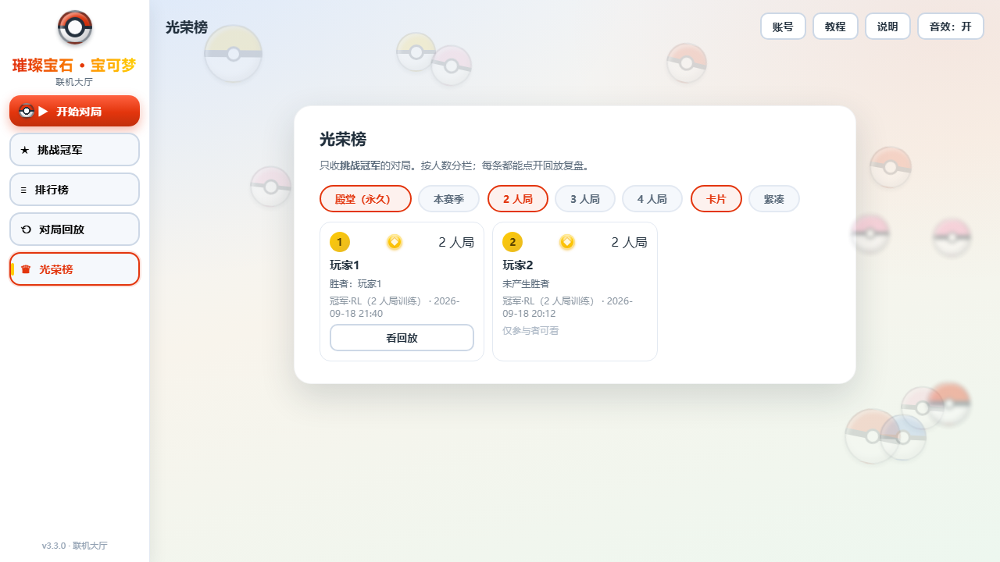

<div align="center">

# 璀璨宝石 · 宝可梦

一个宝可梦主题的《璀璨宝石》网页版同人项目，支持本地游玩、多人联机、对局回放与强化学习 AI。


</div>

> [!IMPORTANT]
> 这是一个非官方、非商业的学习与研究项目，与 Nintendo、Game Freak、The Pokémon Company、Korea Boardgames 及其关联公司无关。公开仓库不包含卡牌原图；第三方名称、商标和图像不属于本项目作者。详见 [NOTICE.md](NOTICE.md)。



## 项目亮点

- **本地与联机双模式**：2–4 人热座、本地电脑玩家、多房间联机和公开/私有房间。
- **完整账号系统**：注册申请、管理员审核、昵称、改密、后台用户管理和分栏日志。
- **服务器权威对局**：HTTP + SSE 通信，支持断线重连、行动超时、结束投票和离线收尾。
- **挑战阿尔宙斯**：独立挑战模式，按 2/3/4 人加载对应的强化学习冠军策略。
- **训练家排行与名人堂**：普通战绩排行、挑战赛季、永久殿堂和可点击回放。
- **对局回放**：保存初始状态与行动序列，支持自动播放、权限隔离和管理员查看。
- **响应式界面**：桌面与手机横屏布局、卡牌动效、音效、减弱动态效果支持。
- **强化学习实验台**：可复现 RNG、无头仿真、PPO、神经网络、对手池和评测工具。

## 技术栈

| 层 | 实现 |
|---|---|
| 前端 | 原生 HTML、CSS、JavaScript |
| 服务端 | Node.js 原生 `http` 模块 |
| 实时通信 | Server-Sent Events（SSE）+ HTTP POST |
| 数据库 | MySQL 8.x、`mysql2` |
| 游戏核心 | 单机与服务器共用 `game-core.js` |
| AI | 启发式策略 + JavaScript 实现的 PPO/MLP 推理 |

## 快速开始

### 环境要求

- Node.js 18 或更高版本
- MySQL 8.x
- Chrome、Edge 或其他现代浏览器

### 1. 获取代码并安装依赖

```bash
git clone https://github.com/ZhuangAOAO/Pokemon-Splendor.git
cd Pokemon-Splendor
npm install
```

### 2. 配置数据库

推荐通过环境变量提供连接信息：

```bash
SPLENDOR_DB_HOST=127.0.0.1
SPLENDOR_DB_PORT=3306
SPLENDOR_DB_USER=root
SPLENDOR_DB_PASSWORD=your-password
SPLENDOR_DB_NAME=splendor
```

也可以复制示例文件并填写本机配置：

```bash
# macOS / Linux
mkdir -p data
cp db.example.json data/db.json

# Windows PowerShell
New-Item -ItemType Directory -Force data
Copy-Item db.example.json data/db.json
```

`data/db.json` 已被 `.gitignore` 排除。不要把真实密码写进 `db.example.json` 或其他已跟踪文件。

### 3. 创建第一个管理员

```bash
node 工具/初始化管理员.js <用户名> <密码>
```

用户名为 2–12 个字符，密码至少 6 位。之后可通过 `/admin` 审核普通用户和管理数据。

### 4. 启动服务器

```bash
npm start
```

常用入口：

| 地址 | 用途 |
|---|---|
| `http://localhost:3000/` | 游戏主页 |
| `http://localhost:3000/admin` | 管理后台 |
| `http://localhost:3000/replay` | 对局回放 |
| `http://localhost:3000/health` | 版本、构建指纹和启动时间 |

服务器首次启动时会自动创建所需数据库和表。

### 本地单机模式

不需要账号和 MySQL 时，可以直接用浏览器打开 `index.html`。本地模式与联机模式共用同一份游戏核心规则。

## 图片资源

由于版权原因，公开仓库不提供 `pictures/` 下的卡牌原图。克隆仓库后，可以使用自己拥有合法使用权的图片或占位图补充该目录。

图片文件名应与 `config.js` 中的卡牌名称对应，例如：

```text
pictures/
├── 妙蛙种子.jpg
├── 妙蛙种子2.jpg
├── 小火龙.jpg
└── ...
```

相关工具：

```bash
node 工具/检查图片.js
node 工具/生成卡牌表.js
```

也可以打开 `工具/录入工具.html`，通过图形界面维护卡牌数据。

## 强化学习 AI

项目包含一套纯 JavaScript 的强化学习实验与产品推理链路：

```text
game-core.js
    ├── 工具/rl/harness.js        # 无头仿真与守恒校验
    ├── 工具/rl/ppo-agent.js      # PPO 训练与评测
    ├── 工具/rl/policy-core.js    # 训练/产品共用特征与动作枚举
    └── ai-policy.js              # 联机服务器中的冠军 AI 推理
```

当前冠军策略按房间人数分别加载模型。训练、评测命令及实验口径参见 [工具/rl/README.md](工具/rl/README.md) 和 [工具/rl/训练计划与评测协议.md](工具/rl/训练计划与评测协议.md)。

## 测试

```bash
# 检查所有 JavaScript 文件语法
npm run check

# 离线规则冒烟；若本地服务器已启动，也会运行可用的联机回归
npm test
```

部分隔离测试使用 `127.0.0.1:3210`，测试服务器未启动时会明确标记为跳过，不计为失败。涉及管理员操作的测试应通过以下环境变量提供临时测试凭据：

```bash
SPLENDOR_TEST_ADMIN=<管理员用户名>
SPLENDOR_TEST_ADMIN_PASSWORD=<管理员密码>
```

也可以参考 `测试/凭证.example.json` 创建本机专用的 `测试/凭证.json`；该文件已被忽略，禁止提交。

## 项目结构

```text
.
├── index.html / client.js / style.css  # 主界面与客户端
├── game-core.js / config.js            # 游戏规则与数据配置
├── server.js / db-config.js            # 联机服务与数据库入口
├── ai-policy.js                        # 冠军 AI 产品推理
├── replay.html / replay.js             # 回放页面
├── admin.html                          # 管理后台
├── 测试/                               # 自动化回归
├── 工具/                               # 数据、仿真与维护工具
│   └── rl/                             # 强化学习训练与评测
└── demo/                               # UI 原型与视觉回归证据
```

## 安全与部署提示

- 不要提交 `data/db.json`、`测试/凭证.json`、日志、部署包、私钥或 `.env` 文件。
- 公网部署应使用 HTTPS 反向代理，不要直接暴露 MySQL 端口。
- `/health` 会返回版本、构建指纹与启动时间，不包含凭据，可用于部署核对。
- 生产环境升级前建议备份数据库和应用目录，并在升级后运行核心回归。

## 当前状态

当前版本为 **v3.4.7**。主要游戏、联机、账号、回放、挑战模式和冠军 AI 已可用；下一阶段重点是游戏桌面信息层级、卡牌状态表达、响应式布局收敛与可访问性。

更详细的版本变化见 [更新日志.json](更新日志.json)。

## 许可与免责声明

本仓库目前**未附加开源许可证**。公开可见不代表授予复制、修改、再发布或商业使用的许可。

宝可梦、《璀璨宝石》及相关名称、角色、图像和商标属于其各自权利人。本项目仅用于学习、研究和非商业展示。完整说明见 [NOTICE.md](NOTICE.md)。
